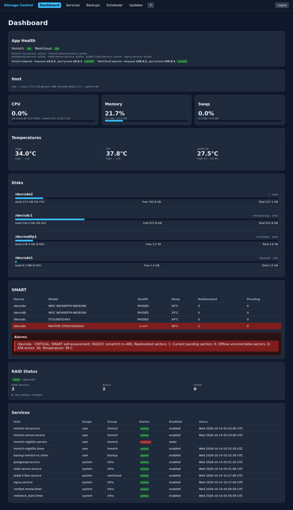
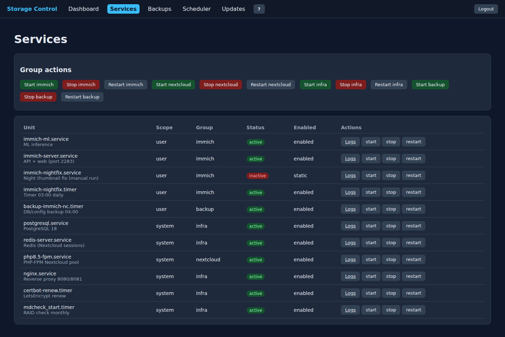
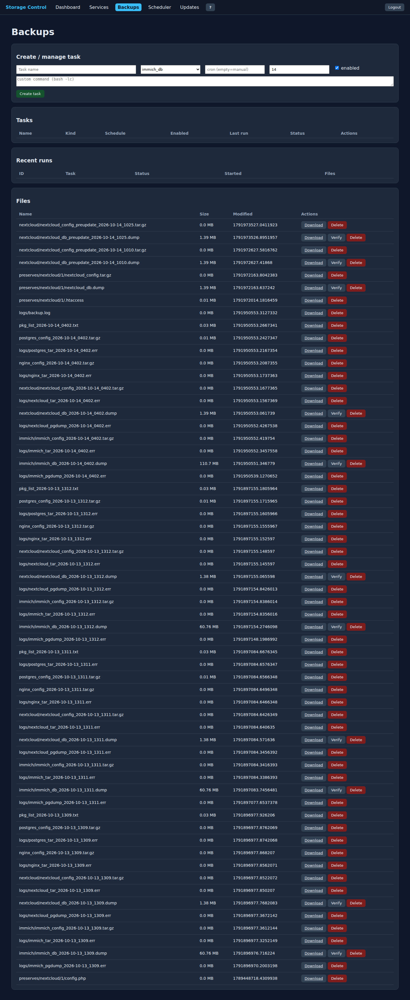
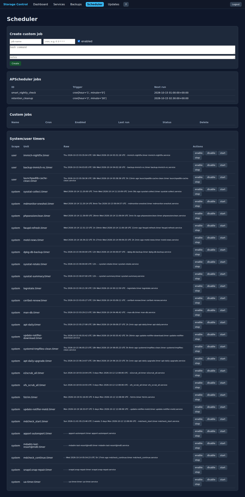
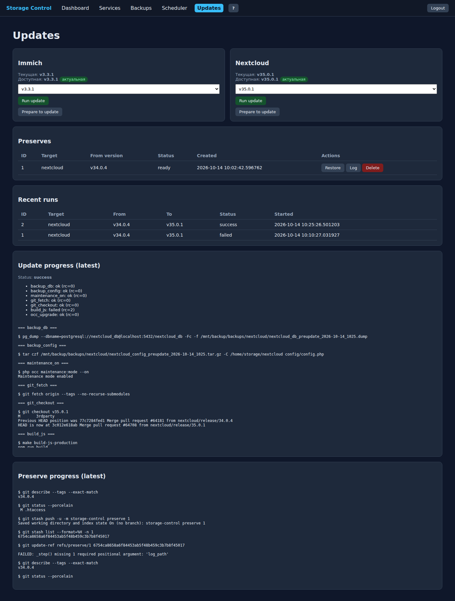

# Storage Control — USERGUIDE

Веб-консоль управления NAS (Immich + Nextcloud).

**Вход:** `http://<адрес_сервера>:8765/`  
**Учетная запись:** автосоздаётся, если задан `ADMIN_PASSWORD` (по умолчанию `admin`).

## 1. Вход в систему

Откройте URL, введите логин и пароль, затем нажмите **Sign in**.

## 2. Dashboard (главная)

Показывает состояние NAS:
- CPU, RAM, Swap
- температуры датчиков
- физические диски
- SMART-состояние и алармы (красным — если обнаружена деградация)
- RAID
- сервисы Immich/Nextcloud

Сверху есть блок **App Health**:
- `Immich: OK/DEGRADED`
- `Nextcloud: OK/DEGRADED`
- текущая и доступная версия для каждого.

## 3. Services

Запуск/остановка/перезапуск:
- системных и пользовательских сервисов (`systemctl`)
- пакетные действия по группам: `immich`, `nextcloud`, `infra`, `backup`

Кнопки:
- `Start` — запустить
- `Stop` — остановить
- `Restart` — перезапустить
- `Logs` — открыть логи юнита

## 4. Backups

Создание и управление задачами резервного копирования:
- типы `immich_db`, `nextcloud_db`, `immich_config`, `nextcloud_config`, `all`, `custom`
- ручной запуск
- редактирование
- удаление задач и файлов

Файлы можно:
- скачать
- проверить (`Verify`)
- удалить (`Delete`, с подтверждением)

## 5. Scheduler

- просмотр APScheduler jobs
- свои Shell-задачи по cron
- системные/пользовательские таймеры
- `enable/disable/start/stop` с whitelisted sudo

## 6. Updates

- текущая версия Immich/Nextcloud
- доступная версия из GitHub Releases
- changelog и ключевые шаги миграции
- **Prepare to update** (бэкапы + git stash, список Preserve)
- **Run update** запускается фоном и показывает прогресс, шаги и лог
- **Restore/Delete** пресетов

Процесс обновления читается через `Progress log (latest running)` и лог-файл.

## 7. SMART и алармы

Ежедневно в 01:00 ночная проверка сравнивает состояние SMART-дисков. Деградация:
- дисковый статус become FAILED
- рост reallocated / pending / offline sectors
- рост ATA-ошибок

Такие диски в Dashboard отмечаются красным ( badge `ALARM` ), а alarm-сообщение показывается под SMART-таблицей.

## 8. Экстренное восстановление

Если после обновления произошла проблема:
- откройте `Preserves`
- нажмите `Restore` (с подтверждением)
- при необходимости удалите пресет кнопкой `Delete`
